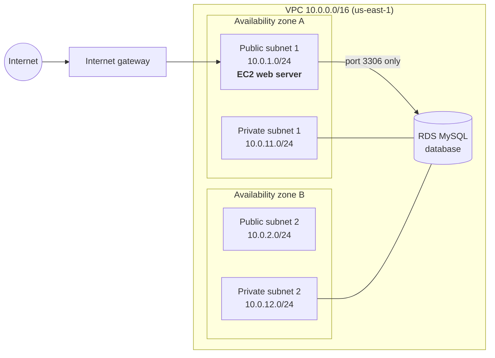

# AWS VPC with EC2 and RDS, Built with Terraform

This project builds a small, secure network in AWS using **Terraform** (infrastructure as code). It contains a web server that anyone on the internet can reach, and a database that is hidden away where only that web server can talk to it.

Everything is created from one file, `main.tf`. One command builds it all, and one command deletes it all.

---

## Table of contents

1. [The big picture](#the-big-picture)
2. [Words you need to know](#words-you-need-to-know)
3. [What gets built](#what-gets-built)
4. [How traffic flows](#how-traffic-flows)
5. [Security: how this is protected](#security-how-this-is-protected)
6. [Day 1: Building the network](#day-1-building-the-network)
7. [Day 2: Making it more secure](#day-2-making-it-more-secure)
8. [How to run it yourself](#how-to-run-it-yourself)
9. [How to test it](#how-to-test-it)
10. [How to shut it down](#how-to-shut-it-down)
11. [Problems I ran into and how I fixed them](#problems-i-ran-into-and-how-i-fixed-them)
12. [What I learned](#what-i-learned)
13. [What I would add next](#what-i-would-add-next)

---

## The big picture

Think of the setup like an office building:

- The **VPC** is the building. It has walls, and nothing gets in unless there is a door.
- The **internet gateway** is the front door.
- The **public subnets** are the lobby. Visitors from outside can walk in.
- The **private subnets** are a locked back office. Visitors can't get there from outside.
- The **EC2 web server** is the receptionist in the lobby. It talks to visitors.
- The **RDS database** is the filing cabinet in the back office. Only the receptionist is allowed to open it.
- The **security groups** are security guards checking who is allowed through each door.



> The database lives in the private subnets. AWS decides which of the two it runs in.

---

## Words you need to know

| Term | Plain-English meaning |
|---|---|
| **AWS** | Amazon Web Services. Renting computers and services from Amazon over the internet. |
| **Terraform** | A tool where you *describe* the infrastructure you want in a file, and it builds it for you. |
| **Infrastructure as code** | Building servers and networks from a text file instead of clicking around a website. |
| **Region** | A geographic area where AWS has data centers. This project uses `us-east-1` (Virginia). |
| **Availability Zone (AZ)** | A separate data center inside a region. Using two means if one has a problem, the other keeps going. |
| **VPC** | Virtual Private Cloud. Your own private, walled-off network inside AWS. |
| **CIDR block** | A way of writing a range of IP addresses. `10.0.0.0/16` means about 65,000 addresses. `/24` means 256. |
| **Subnet** | A smaller section of the VPC. Each one lives in a single AZ. |
| **Public subnet** | A subnet whose traffic can reach the internet through the internet gateway. |
| **Private subnet** | A subnet with no route to the internet. Things inside can't be reached from outside. |
| **Internet gateway (IGW)** | The door between your VPC and the internet. |
| **Route table** | Directions that tell traffic where to go. "To reach the internet, go through the gateway." |
| **EC2** | A virtual server (a computer) running in AWS. |
| **RDS** | Relational Database Service. AWS runs and maintains the database for you. This one runs MySQL. |
| **Security group** | A firewall attached to a server. It lists exactly what traffic is allowed in and out. |
| **Port** | A numbered "door" on a computer. Port 22 = SSH, port 80 = websites, port 3306 = MySQL. |
| **SSH** | A way to log into a server's terminal from your own computer using a key file. |
| **Key pair / .pem file** | The key used for SSH. AWS keeps the "lock," you keep the `.pem` "key." |
| **IAM** | Identity and Access Management. Controls *who* can do *what* in AWS. |
| **IAM role** | A set of permissions that a service (like an EC2 server) can use. |
| **Session Manager** | An AWS tool that gives you a terminal on a server *without* SSH, keys, or open ports. |
| **Least privilege** | Giving every person and system only the access it truly needs, nothing extra. |

---

## What gets built

| Resource | How many | What it does |
|---|---|---|
| VPC | 1 | The private network that holds everything |
| Internet gateway | 1 | Connects the VPC to the internet |
| Public subnets | 2 (one per AZ) | Where internet-facing servers go |
| Private subnets | 2 (one per AZ) | Where the database goes, hidden from the internet |
| Public route table | 1 | Sends public subnet traffic out through the internet gateway |
| EC2 security group | 1 | Allows website traffic (port 80) in |
| RDS security group | 1 | Allows database traffic (port 3306) **only from the EC2 server** |
| EC2 instance | 1 | `t3.micro` Amazon Linux 2023 web server in public subnet 1 |
| DB subnet group | 1 | Tells RDS it may use the two private subnets |
| RDS instance | 1 | `db.t3.micro` MySQL database in a private subnet |
| IAM role + instance profile | 1 each | Lets the EC2 server use Session Manager, and nothing else |

### IP address plan

| Subnet | AZ | IP range | Type |
|---|---|---|---|
| public-1 | A | `10.0.1.0/24` | Public |
| public-2 | B | `10.0.2.0/24` | Public |
| private-1 | A | `10.0.11.0/24` | Private |
| private-2 | B | `10.0.12.0/24` | Private |

---

## How traffic flows

**A visitor loading the website:**

1. The visitor's browser sends a request from the internet.
2. It enters the VPC through the **internet gateway**.
3. The **public route table** sends it to public subnet 1.
4. The **EC2 security group** checks it. Port 80 is allowed, so it reaches the web server.

**The web server reading from the database:**

1. The EC2 server sends a request to the database on port 3306.
2. The VPC's built-in local route delivers it to the private subnet.
3. The **RDS security group** checks: *"Is this coming from the EC2 security group?"* Yes, so it is allowed.

**Someone on the internet trying to reach the database directly:**

1. They can't. The database has no public address, the private subnets have no route to the internet, and the RDS security group only trusts the EC2 server. Three separate layers block them.

---

## Security: how this is protected

| Protection | What it stops |
|---|---|
| **Database in private subnets** | Nobody on the internet can even find the database. |
| **RDS security group trusts only the EC2 security group** | Even inside the VPC, only the web server can reach the database. |
| **`publicly_accessible = false` on RDS** | AWS never gives the database a public IP address. |
| **No SSH (port 22 closed)** | Nobody can try to break into the server through SSH. |
| **Session Manager for admin access** | Access is controlled by IAM permissions and logged, instead of a key file that could be copied or lost. |
| **EC2 role has one narrow policy** | If the server were ever hacked, its permissions are nearly useless to an attacker. |
| **Database password entered at runtime** | The password is never written in the code. |

This is **least privilege** applied at two levels:

- **Network level:** only the traffic that's needed is allowed through.
- **Identity level (IAM):** the server, and the people managing it, only get the permissions they need.

---

## Day 1: Building the network

**Goal:** Build a VPC across two Availability Zones with public and private subnets, an EC2 server, and an RDS database, then prove the server can reach the database.

### Step 1: Set up Terraform and create the VPC

- Created a folder called `vpc-setup` and a file called `main.tf`.
- Told Terraform to use the AWS provider and the `us-east-1` region.
- Created a VPC with the range `10.0.0.0/16`.
- Ran `terraform init`, `terraform plan`, and `terraform apply`.

### Step 2: Look up the Availability Zones and add an internet gateway

- Used a `data` block to ask AWS which AZs are available (it looks things up but creates nothing).
- Created an internet gateway and attached it to the VPC.

### Step 3: Create four subnets

- Used `count = 2` to make two public and two private subnets, one of each in each AZ.
- Public subnets automatically give servers a public IP (`map_public_ip_on_launch = true`).

### Step 4: Set up public routing

- Created a route table that sends all internet traffic (`0.0.0.0/0`) to the internet gateway.
- Connected that route table to the two public subnets only.
- The private subnets were left alone, so they have no internet route. **That is what makes them private.**

### Step 5: Create security groups

- **EC2 security group:** allowed SSH (port 22) from my IP only, and HTTP (port 80) from anywhere.
- **RDS security group:** allowed MySQL (port 3306) only from the EC2 security group.

### Step 6: Launch the EC2 server

- Used a `data` block to automatically find the newest Amazon Linux 2023 image.
- Chose `t3.micro` (free-tier eligible).
- Created a key pair in the AWS console and connected with SSH.

### Step 7: Launch the RDS database

- Created a DB subnet group using both private subnets. **RDS requires subnets in at least two AZs**, which is a big reason for having two.
- Created a MySQL database with `publicly_accessible = false`.

### Step 8: Test the connection

- SSH'd into the EC2 server.
- Used `nc` (netcat) to test whether the database port was reachable:

```bash
nc -zv <rds-endpoint> 3306
# Ncat: Connected to 10.0.11.225:3306.
```

> **Why not `ping`?** RDS doesn't respond to ping. Testing the real database port is a better test anyway, because it's how an application actually connects.

---

## Day 2: Making it more secure

**Goal:** Remove SSH completely and use AWS Systems Manager Session Manager instead.

### Why

| SSH | Session Manager |
|---|---|
| Needs port 22 open to the internet | Needs **no** open inbound ports |
| Access = whoever has the `.pem` file | Access = whoever IAM allows |
| Hard to tell who logged in | Every session is logged in CloudTrail |
| Keys can be copied, lost, or shared | Access can be removed instantly in IAM |

### How Session Manager works

A small program called the **SSM agent** runs on the server (it comes pre-installed on Amazon Linux 2023). It reaches *out* to AWS. When you click "Connect" in the console, AWS passes your session through that outbound connection. Nothing ever has to come *in*.

### Step 1: Give the EC2 server an IAM role

Added three pieces to `main.tf`:

1. **`aws_iam_role`**: a role that EC2 servers are allowed to use.
2. **`aws_iam_role_policy_attachment`**: attached one AWS policy, `AmazonSSMManagedInstanceCore`, which allows Session Manager and nothing else.
3. **`aws_iam_instance_profile`**: the wrapper that lets the role be attached to an EC2 server.

Then attached it to the server:

```hcl
iam_instance_profile = aws_iam_instance_profile.ec2_ssm.name
```

### Step 2: Test Session Manager (while SSH still worked)

- Kept SSH open as a backup so I couldn't lock myself out.
- Connected through **EC2 → Instances → Connect → Session Manager**.
- From inside the session, tested the database again:

```bash
nc -zv <rds-endpoint> 3306
# Ncat: Connected to 10.0.12.145:3306.
```

This time the database was in **private subnet 2 (AZ B)**, and the server in AZ A still reached it. The two-AZ design working as intended.

### Step 3: Remove SSH

- Deleted the port 22 rule from the EC2 security group.
- Deleted `key_name` from the EC2 server.
- Deleted the now-unused `my_ip` variable.
- Ran `terraform apply`.

### Step 4: Prove SSH is closed

From my Mac, the old SSH command now **hangs with no response**. The security group silently drops the request because the door no longer exists. Session Manager still works.

---

## How to run it yourself

### What you need

- An AWS account
- [Terraform](https://developer.hashicorp.com/terraform/install) installed
- [AWS CLI](https://docs.aws.amazon.com/cli/latest/userguide/getting-started-install.html) installed and logged in
- VS Code (optional, but helpful)

### Commands

```bash
cd vpc-setup

terraform init      # download the AWS provider (first time only)
terraform fmt       # clean up formatting
terraform plan      # preview what will be built (nothing changes yet)
terraform apply     # build it (type "yes" to confirm)
```

Terraform will ask for a database password. Use at least 8 characters, and don't use `/`, `@`, `"`, or spaces.

RDS takes about **5 to 10 minutes** to create. That's normal.

To see the results:

```bash
terraform output
```

---

## How to test it

1. Open the AWS console and go to **EC2 → Instances**.
2. Select `vpc-setup-web` and click **Connect → Session Manager → Connect**.
3. In the terminal that opens:

```bash
sudo su - ec2-user
sudo dnf install -y nmap-ncat
nc -zv <rds-endpoint-without-:3306> 3306
```

4. If you see `Connected to 10.0.1x.x:3306`, the web server can reach the database.

> **Tip:** Two different terminals look similar.
> - `yourname@your-mac ... %` is **your Mac** (run Terraform here).
> - `sh-5.2$` or `[ec2-user@ip-10-0-...]$` is **the EC2 server** (run tests here).

---

## How to shut it down

EC2 and RDS cost money (or free-tier credits) while they run. When you're done:

```bash
terraform destroy
```

Type `yes` to confirm. To bring everything back later, just run `terraform apply` again.

---

## Problems I ran into and how I fixed them

| Problem | Cause | Fix |
|---|---|---|
| `Duplicate variable declaration` | Pasted the same blocks into `main.tf` twice | Deleted the duplicate copies at the bottom |
| IP address caused an error | IP wasn't in quotes | Text values need quotes: `["1.2.3.4/32"]` |
| `syntax error near unexpected token 'newline'` | Typed the placeholder `<rds-endpoint>` literally | Replaced it with the real endpoint, no angle brackets |
| `ping` wouldn't reach RDS | RDS doesn't answer ping | Used `nc -zv <endpoint> 3306` instead |
| Session Manager said "Not connected" | The SSM agent hadn't picked up the new IAM role yet | Restarted the agent: `sudo systemctl restart amazon-ssm-agent` |
| Removing `key_name` didn't replace the server | Terraform keeps values AWS remembers when you delete them from code | Harmless, since port 22 is closed. Optional: `terraform apply -replace="aws_instance.web"` |
| SSH test gave "terraform: command not found" | Ran it on the EC2 server instead of my Mac | Ran it in the Mac terminal instead |

---

## What I learned

- **Public vs. private isn't a checkbox.** A subnet is public only because its route table points to an internet gateway.
- **Security groups can trust other security groups,** not just IP addresses. That's how the database trusts only the web server.
- **Two Availability Zones** protect against a data center outage, and RDS requires them.
- **Terraform figures out the order** to build things by looking at what depends on what.
- **Test in small steps.** Running `terraform plan` after every change made problems easy to find.
- **Don't lock yourself out.** Set up the new access method and test it *before* removing the old one.
- **Least privilege** applies to both networks (what traffic is allowed) and identities (what permissions exist).

---

## What I would add next

- **Encrypt storage at rest:** `storage_encrypted = true` on RDS and an encrypted EC2 disk.
- **Let AWS manage the database password** with `manage_master_user_password = true` (stored in Secrets Manager).
- **Require IMDSv2** on EC2 to protect the server's temporary credentials.
- **Lock down the VPC's default security group** so nothing can accidentally use it.
- **Turn on VPC Flow Logs** to record network traffic for investigations.
- **Add a load balancer** and move the web servers into private subnets (three-tier architecture).
- **Store Terraform state in an encrypted S3 bucket** instead of on my laptop.
- **Stop using the AWS root account** for daily work, and use an IAM Identity Center admin user with MFA instead.

---

## Files in this project

```
vpc-setup/
├── main.tf        # All the infrastructure, written in Terraform
└── README.md      # This file
```

> **Never upload these to GitHub:** `terraform.tfstate` (contains the database password in plain text), `.terraform/`, `*.tfvars`, and any `.pem` key files. Add them to a `.gitignore` file.
